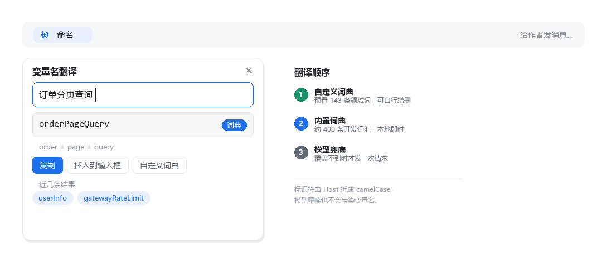

# Naming Translator（命名翻译器）

把中文表述直接翻译成代码里能用的 **camelCase 变量名 / 方法名**，控件常驻在输入框工具行左侧。

```
用户信息        →  userInfo
订单分页查询    →  orderPageQuery
登录失败原因    →  loginFailReason
```

[](https://github.com/deepseek-ai/deepseek-harness)
[](LICENSE)
[](PUBLISHING.md)



*Panel as it behaves: the identifier in this shot is what the shipped tokenizer actually returns.*

- 输入中文，得到能直接敲进代码的标识符——不用切窗口，不用问模型再手动改写。
- **词典优先**：内置约 400 条开发词汇 + 预置 143 条领域词条，全部本地即时出结果。
- **模型兜底**：前两步覆盖不到的部分才发一次请求，且由 Host 折成 camelCase，模型啰嗦也不会污染变量名。
- 无依赖、无构建步骤，`dsh plugin add` 装完即用。

## 怎么用

1. 点击输入框工具行左侧的 **`{}` 命名** 按钮，弹出面板。
2. 在输入框里打中文，结果实时出现。
3. **复制** 放到剪贴板，或 **插入到输入框** 直接写到当前草稿的光标位置。

面板里还有：

- **来源标记**：`词典` / `自定义` / `模型`，一眼看出这条结果是查表得到的还是问了模型。
- **近几条结果**：点一下即可复用，省得重复输入。
- **自定义词典**：每行 `中文=english`，例如 `门店=store`。自定义词优先于内置词典，存在本机 `localStorage`（键 `dsh-naming-translator/glossary`），不会上传。

快捷键：面板内 `Enter` 记住当前结果，`Esc` 关闭面板。

## 自定义词典已经预置了 143 条

首次运行时，插件会把 143 条**常用领域词条**写进自定义词典，打开编辑器就能直接改，不用对着空框发愁。这些词故意没有放进内置词典——它们要么偏业务，要么偏特定团队，放内置里会让所有人都背着：

| 分组 | 例子 |
|---|---|
| 业务 / 增长 | 门店 `store`、渠道 `channel`、核销 `redeem`、裂变 `referral`、复购 `repurchase`、看板 `dashboard`、埋点 `track` |
| 交易 / 履约 | 预售 `presale`、尾款 `balance`、退货 `return goods`、入库 `inbound`、运单 `waybill`、分账 `split account`、税率 `tax rate` |
| 架构 / 后端 | 网关 `gateway`、幂等 `idempotent`、熔断 `circuit breaker`、限流 `rate limit`、降级 `degrade`、阈值 `threshold`、灰度 `gray` |
| 前端 | 防抖 `debounce`、节流 `throttle`、虚拟列表 `virtual list`、懒加载 `lazy load`、骨架屏 `skeleton` |

有了这些词条，`门店渠道 → storeChannel`、`熔断阈值 → circuitBreakerThreshold`、`用户画像查询 → userProfileQuery` 都能**本地即时得出**，不必再等一次模型往返。

播种规则（`loadGlossary`）：

- **只播一次**。播完写入 `dsh-naming-translator/seeded` 标记；之后即使你把词典清空，也不会被重新填回来。
- **你的词条永远优先**。已有的同名条目会覆盖预置值，例如你写了 `门店=shop`，就是 `shop`。
- **随时可恢复**。编辑器里的 **恢复预置词条** 按钮会把 143 条重新装回去（只装预置词条，不保留其他改动）。
- 预置词条与内置词典**零重叠**，只增加覆盖范围，不会改变任何已有短语的切分结果。

## 翻译顺序

| 顺序 | 来源 | 说明 |
|---|---|---|
| 1 | 自定义词典 | 用户自己维护的词条，优先级最高；**首次运行已预置 143 条常用领域词** |
| 2 | 内置词典 | 约 400 条常用开发词汇，纯本地、零延迟 |
| 3 | 模型兜底 | 只有在前两步**无法完整覆盖**时才调用，结果由 Host 再折成 camelCase |

内置词典做的是**最优分词**（动态规划），不是贪心最长匹配，所以 `用户名称` 会切成 `用户` + `名称` → `userName`，而不是被 `用户名` 吃掉后剩下一个孤零零的 `称`。

中文里的「的 / 了 / 请 / 一个」这类虚词会被丢弃，不进入标识符。

## 模型兜底怎么走

浏览器**不直接**找模型，也不持有任何凭据。Host 半边在 Harness web server 上开了一个插件私有路由：

```
POST /naming-translator/translate
headers: { 'content-type': 'application/json', 'x-naming-translator': '1' }
body:    { "text": "订单分页查询" }
→        { "ok": true, "identifier": "orderPageQuery", "words": [...], "source": "model", "cached": false }
```

Host 用 `ctx.llm.stream()` 发一次单轮请求，模型只需要回一串英文词；**标识符由 Host 自己折成 camelCase**，所以即使模型啰嗦地解释了一整句，也不会把散文写进变量名。默认模型取 profile 的 `agent-default-model`，没有则回退到第一个有模型的 provider。

该路由的行为边界：

- 只接受 `POST`，且必须带 `x-naming-translator: 1`（挡住跨站表单提交）；
- 正文 ≤ 8 KiB，短语 ≤ 240 字符；
- 同一短语的结果在进程内缓存（最多 128 条），重复输入不再打模型；
- 同时最多 2 个在途模型调用，多余的返回 `429 BUSY`；
- 模型答非所问（例如把「无输入」形态的 `no phrase provided` 原样回显）会被识别成失败而不是变量名，返回 `NO_GLOSS` 并把原始回答放在 `answer` 字段里，便于排查；
- 其余失败一律是带 `code` 的 JSON（`NO_MODEL` / 模型自身的失败码），面板会显示原因并保留词典结果。

## 安装

这是标准的 DSH bundle 插件，包名 `dsh-naming-translator`，没有任何依赖和构建步骤。

**从 npm**（发布后可用）：

```bash
dsh plugin add dsh-naming-translator
```

**从本地目录**（开发或自用）：

```bash
dsh plugin add /path/to/naming-translator
```

**图形界面**：插件页 → 添加插件 → 选择本地目录。

装完在 profile 的 `cordis.patch.yml` 里会多出一行 `naming-translator`；重启（或等客户端 HMR 生效）后控件出现在输入框工具行。

要求 `engines.dsh >= 0.2.2-rc.3`；低于这个版本 Host 会拒绝安装并给出 `incompatible-version`。

## 发布上线

见 [PUBLISHING.md](PUBLISHING.md)：npm 发布、GitHub 直装、上架官方插件市场的完整流程与门槛。

## 卸载

把插件禁用或删除即可。控件、样式、locale 字典都由同一个 `ctx.effect` 持有，卸载时一并释放；本机自定义词典随之失效，但文件仍在 `localStorage` 里，重装后自动恢复。

## 目录

| 文件 | 作用 |
|---|---|
| `package.json` | bundle 清单：`dsh.bundle.patch`、`dsh.client`、图标、locale 导出 |
| `cordis.patch.yml` | 插入 Host 行 |
| `index.js` | Host 半边：模型兜底路由、缓存、限流、错误码 |
| `client.js` | 浏览器半边：词典、分词、UI、样式、locale 字典 |
| `locale/en.json`、`locale/zh.json` | 插件在插件列表里的标题与描述 |
| `icon.svg` | 插件图标 |
| `LICENSE` | MIT 许可证 |
| `PUBLISHING.md` | 发布上线流程（不进发布包） |
| `tools/dnt-*.cjs`、`tools/dnt-*.mjs` | 自检脚本（见下，不进发布包） |

## 自检

```bash
npm test
```

七组检查，全部离线、不需要浏览器：

| 脚本 | 覆盖 |
|---|---|
| `dnt-test.cjs` | 词典分词与 camelCase、自定义词典覆盖、未覆盖字符识别、**预置词条的播种生命周期**（仅播一次 / 清空后不回填 / 已有条目优先） |
| `dnt-seed-audit.cjs` | 逐条审计 143 条预置词：每条单独解析正确、不被内置组合抢走、与内置词组合成正常 |
| `dnt-host-test.mjs` | Host 路由：方法/请求头/JSON/长度校验、模型结果折算、缓存、限流、`502` 分类 |
| `dnt-manifest-test.cjs` | 清单完整性、可发布性、`engines.dsh`、注册 id 与包名一致、locale 键对齐、图标体积 |
| `dnt-render-test.cjs` | 用桩 hooks 运行时渲染组件：触发按钮、面板、实时结果、来源标记、**预置词条出现在编辑器里** |
| `dnt-apply-test.cjs` | 插件体：字典注册、样式注入与卸载、唯一槽位注册 |
| `dnt-token-test.cjs` | CSS 只用真实存在的主题令牌，且每条规则都被 `data-` 作用域限定 |

发布前还有一个不在 `npm test` 里的打包验证（需要先 `npm pack`）：

```bash
npm pack
tar -xzf dsh-naming-translator-*.tgz
node tools/dnt-tarball-check.mjs ./package
```

它会解包真实产物，挂载 Host 半边、实际调一次路由、再加载浏览器半边，确认发布出去的就是能跑的。

> `dnt-token-test.cjs` 需要读 Harness 的主题令牌表，而该文件在 `app.asar` 里，普通 Node 读不到。用系统 `node` 跑时它会**跳过**并打印提示；要真正校验请用：

```powershell
$env:ELECTRON_RUN_AS_NODE='1'; & $env:DSH_NODE_EXECUTABLE tools/dnt-token-test.cjs
```

另有一个联机脚本 `tools/dnt-served-check.mjs`：它按 client-modules 的算法复算出本包的 `rev`，再从运行中的 Host 拉取 `/plugins/??<id>/client.js&rev=<rev>`，确认浏览器半边确实被组装并送达。

## 已知限制

- 只输出 camelCase。PascalCase / snake_case / kebab-case / CONSTANT 这几种风格没有实现。
- 分词词典是人工维护的，遇到领域专有词请用**自定义词典**补，或让模型兜底。
- 模型兜底需要 profile 里至少配置一个可用的 provider 与模型。
- 内置词典不区分单复数、时态，输出的是最常见的那一种写法。
